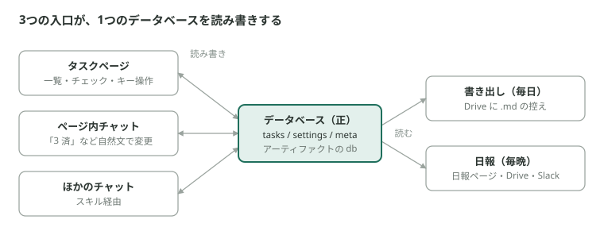

# 設計書

タスクの正（マスター）は、claude.ai のアーティファクト「タスクページ」に付いたデータベース1つです。画面での操作、ページ内のチャット、ほかの Claude チャット（スキル経由）の3つの入口が、同じデータを読み書きします。自前のサーバーや常時起動の PC は要りません。

## 構成要素

| 要素 | 役割 | 実体 |
| --- | --- | --- |
| タスクページ | 一覧の表示と操作。PC でもスマホでも開ける | claude.ai のアーティファクト（`index.html` 1ファイル） |
| データベース | タスクの正。変更はその場で保存され、全端末に反映 | アーティファクトの db 機能（`tasks` `settings` `meta` `nippou`） |
| ページ内チャット | 自然文での変更・追加 | アーティファクトの sample 機能（開いた人の claude.ai アカウントで Claude を呼ぶ）＋ページ側のツール関数 |
| スキル | ほかのチャットから「タスク確認して」「これ追加して」 | claude.ai のスキル（`skill/SKILL.md`） |
| 書き出し（任意） | 控えの `.md` を作り、完了から14日過ぎたタスクを消す | スケジュールタスク＋Google Drive コネクタ（`prompts/daily-export.md`） |
| 日報（任意） | 前日に完了したタスクと感想メモを日報にまとめる | スケジュールタスク（`prompts/daily-report.md`） |

## データ設計

タスクは1件＝1ドキュメント（`tasks/<id>`）。親子は `parent` に親の id を持つだけです。空の項目は持たせません。

| 項目 | 内容 | 例 |
| --- | --- | --- |
| `name` | タスク名 | 契約書の修正 |
| `pj` | プロジェクトのタグ名（「取引先/案件」） | `取引先A/案件1` |
| `kind` | `仕事` か `私用`（画面では「プライベート」） | `仕事` |
| `status` | `todo` / `done` / `cancel` | `todo` |
| `due` / `start` | 期限・開始日。`MM/DD`、半年より先は `YYYY/MM/DD` | `11/27` |
| `born` / `from` | 発生日と発生元（画面には出さない） | `11/22` / `タスクページ` |
| `rep` | 繰り返し（`月次` `年次`） | `年次` |
| `notes` | 補足の配列。1要素＝1行 | `["11/22: 金曜に順延"]` |
| `memo` | メモ原文（改行つき、文面は変えない） | |
| `links` / `refs` / `extra` | 関連URL／参照ファイル／その他 | |
| `hold` | 保留なら `true` | |
| `parent` | 親タスクの id（3階層まで） | `t044` |
| `closedAt` / `closedTs` / `closeNote` | 完了・取消の日付・時刻（ミリ秒）・理由 | `11/23` |
| `extId` | メールや Slack 由来の重複防止ID | `id:gmail:…` |
| `seq` | 並びの元になる数字（新規は作成時刻のミリ秒） | |

ほかのドキュメント：

- `settings/view`：`names`（カテゴリの表示名の上書き）、`order`（↑↓で並べ替えた順）。ページで本人が変える
- `meta/info`：`caseMemo`（タスクではない案件メモの配列。新しいものを先頭）
- `nippou/<YYYY-MM-DD>`：日報メモ。`good` `insight` `struggle` `tomorrow` の配列（本人の文章そのまま）

読み書きの権限は「編集者以上」（`read: admin, write: admin`）。共有しても、閲覧者には中身が見えません。

## 画面設計

左がタスク一覧、右がチャットと変更履歴の2列。スマホでは1列になり、チャットは右下のボタンから下に開きます。常にライトモード。

**ヘッダー（スクロールしても上に残る）**：タイトル／検索（⌘K、画面上部に浮かぶ）／プロジェクト（⌘J、入力で絞れる複数選択。絞ったものを一括チェック）／期限（すべて・切れ・今日）／プライベート（含める・プライベートだけ・仕事だけ）／保留・完了・これから。件数は出しません。

**一覧**：プロジェクトごとのカード。見出しはスクロールしても残り、押すと名前を変えられ、↑↓で順番を動かせます。全タスクに通し番号（チャットで使う）。タイトル右の「ID」で固定IDをコピー。

**タスクを開いたとき**：名前・プロジェクト・期限をその場で変更。補足は入力欄で直接編集。「内容をコピー」で Claude に貼れる Markdown をコピー。完了・取消・保留・子タスクの追加。

**別画面**：完了・取消（直近14日、新しい順）、これから（開始日が先のもの。同じ名前・同じ日付のものは1行にまとめる）。

**キー操作**（入力欄にいないとき）

| キー | 動き |
| --- | --- |
| 1〜7 / w | その日数以内（w＝1週間）。期限切れも含む |
| 0 | 期限切れだけ |
| t | 今日やるもの（今日が期限＋期限切れ） |
| a | すべてに戻す（検索とプロジェクトも解除） |
| p | プライベート：含める→プライベートだけ→仕事だけ |
| c | チャット欄へ |
| ⌘K または / | 検索 |
| ⌘J または g | プロジェクトを選ぶ |
| ⌘Z | 直前の変更を戻す |
| esc | 入力欄から抜ける |

## ルール

- **並び順**：期限の近いタスクがあるカテゴリから。`CONFIG.groups` の塊は離さず続け、`order` があればその順。`personal: true` の塊は最後。↑↓で並べ替えたら、その順が優先
- **期限の印**：切れと今日＝赤丸、3日以内＝黄丸。親は子・孫の一番急ぎの印に合わせる
- **開始日**：`start` が先のタスクは「これから」だけに出て、その日が来たら一覧に移る
- **繰り返し**：`rep: 年次` は完了にすると翌年分（子も含む）を自動で作る。取消にすると繰り返しをやめる
- **階層**：親＞子＞孫の3段まで。親を完了・取消にすると下も同じに。子は親と同じプロジェクト
- **プライベート**：`kind: 私用` は日報や共有物に載せない
- **完了・取消**：消さずに `status` を変える。14日過ぎたものは毎日の書き出しが消す
- **番号**：表示した瞬間の通し番号でデータには保存しない。続けて操作するときは ID を使う

## ページ内チャットの動き

送信すると「打った文章」と「画面に出ているタスクの番号・ID・名前・プロジェクト・期限・保留」を Claude に渡します。補足やメモ原文は渡しません。Claude が使えるのは次のツールだけで、実行した変更はその場で保存され、⌘Z で戻せます。

| ツール | 使いどころ |
| --- | --- |
| complete_tasks / cancel_tasks | 「3 済」「t043 不要」 |
| set_due | 「12 を金曜に」 |
| add_task | 追加。`children` で子も一緒に作れる。作ったタスクの ref を返すので、番号がなくてもその下に足せる |
| rename_task / move_task | 名前の変更／別プロジェクトへ |
| move_under | 「1 を 7 の下へ」「親から外す」 |
| add_note / set_hold | 補足を足す／保留 |
| add_nippou_memo | 「発見は○○」などの日報メモ（タスクではない） |

## 注意点と制約

- **正は1か所だけ**：タスクは必ずこのデータベースに書く。ほかのツールにも書くと、どちらが最新か分からなくなる
- **Google Drive コネクタは既存ファイルを上書きできない**：控えは毎回「新しい版を作り、古い版をゴミ箱へ」
- **PC のフォルダを使うスケジュールタスクは止まりやすい**：フォルダの許可が付いていないと何も書かずに終わる。クラウドで動かすほうが安定
- **番号は表示ごとに変わる**：ほかのチャットには ID で伝える
- **ショートカットはページを一度クリックしてから**：⌘K・⌘J が取られたら / と g を使う
- **チームで使うなら権限の設計から**：今の設定は所有者と編集者だけが読み書きできる
