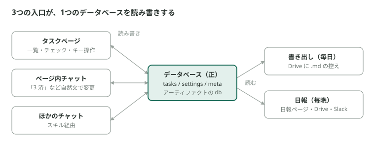

# タスクページ（Claude アーティファクト版）

claude.ai の上だけで動く、個人用のタスク管理ページです。サーバーもアプリのインストールも要りません。HTML 1ファイルを claude.ai のアーティファクトとして公開すると、自分専用のタスク管理になります。



## できること

- 案件（プロジェクト）ごとのカード一覧。期限切れと今日は赤丸、3日以内は黄丸
- 右側のチャットで「3 済」「12 を金曜に」「取引先Aに水曜までで○○を追加、子に△△」のように頼むと、Claude がその場で実行して保存
- 親＞子＞孫の3階層、毎月・毎年の繰り返し、開始日が先のタスクは「これから」画面へ
- 親の期限は、子の一番遅い期限まで自動で延ばす。日数で絞り込むと、条件に合う子とその親だけを表示
- ドラッグ＆ドロップ（カテゴリの並び替え／タスクの上に落として子にする／見出しに落としてプロジェクト移動）。子を「親タスクにする」ボタンも
- 番号はページを開き直すまで固定。チャットで続けて指示しても番号がずれない
- リンクは見出し＋URLで1行ずつ表示。claude.ai のリンクがあるタスクには目印を表示
- キーボード操作（1〜7／w 日数、0 期限切れ、t 今日、a すべて、p プライベート、c チャット、⌘K 検索、⌘E プロジェクト、⌘Z 元に戻す）
- タスクのIDコピー、補足の直接編集、中身を Markdown でコピー
- PC でもスマホ（Claude アプリ）でも同じデータ。常にライトモード

## 必要なもの

- claude.ai の有料プラン（アーティファクトが使えること）
- 任意：Google Drive コネクタ（毎日の控えを Drive に残すなら）、スケジュールタスク（自動処理を使うなら）

## 5分で立ち上げる

1. このリポジトリの `index.html` を開き、先頭の `CONFIG`（設定）を自分用に書き換える
   - `projectNames`：プロジェクトのタグ名と表示名
   - `groups`：まとめて並べたい取引先や事業
   - `ownerName`：チャットで Claude があなたを呼ぶ名前
2. claude.ai の新しいチャットに `index.html` を添付して、こう頼む：

   ```
   添付の index.html を、そのままアーティファクトとして公開してください。
   公開したら、ページの機能（capabilities）を次のように設定してください。
   {"db": {"rules": [{"path": "", "read": "admin", "write": "admin"}]}, "user": {}, "sample": {}}
   ```

3. できたページを開き、右のチャットで「取引先Aに、明日までで企画書のレビューを追加」と送ってみる
4. 既存のタスクがあれば、メモやほかのツールの書き出しを Claude に渡して「このページのデータベースに入れて」と頼む（項目は [DESIGN.md](DESIGN.md) の「データ設計」）

## 応用（任意）

| やりたいこと | 使うもの |
| --- | --- |
| ほかのチャットから「タスク確認して」「これ追加して」 | [skill/SKILL.md](skill/SKILL.md) をスキルとして保存 |
| 毎日 Markdown の控えを Drive に残す／古い完了を掃除する | [prompts/daily-export.md](prompts/daily-export.md) をスケジュールタスクに |
| 日報（その日の完了タスク＋感想）を毎晩まとめる | [prompts/daily-report.md](prompts/daily-report.md) をスケジュールタスクに |

どれも、ファイル中の `<タスクページのslug>` などの `<…>` を自分の値に置き換えてから使います。

## 注意

- データは claude.ai の、そのアーティファクトのデータベースに保存されます。読み書きできるのは所有者（と編集者として招待した人）だけです。
- チャットで送信すると、画面に出ているタスクの番号・名前・期限が Claude に渡ります（補足やメモは渡しません）。
- 詳しい設計は [DESIGN.md](DESIGN.md) を見てください。
